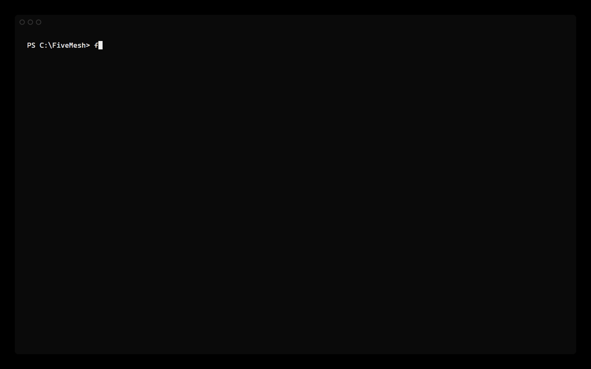
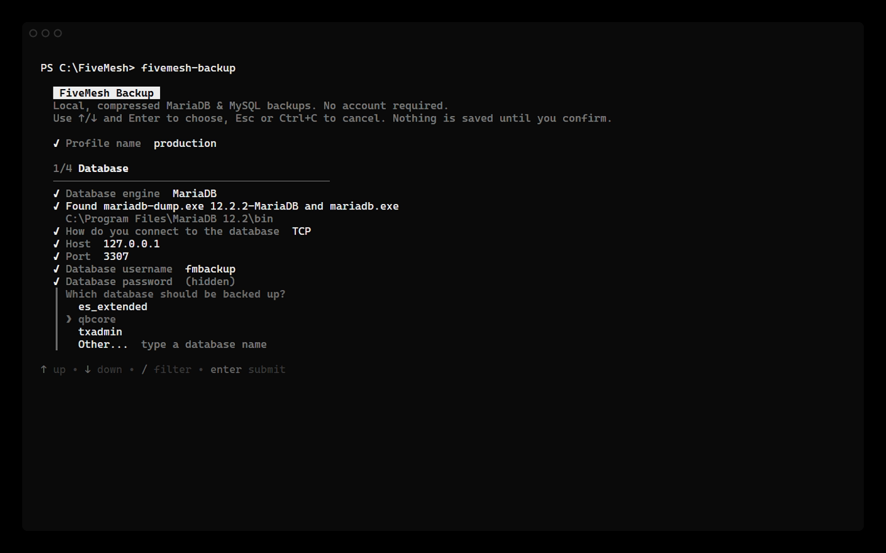
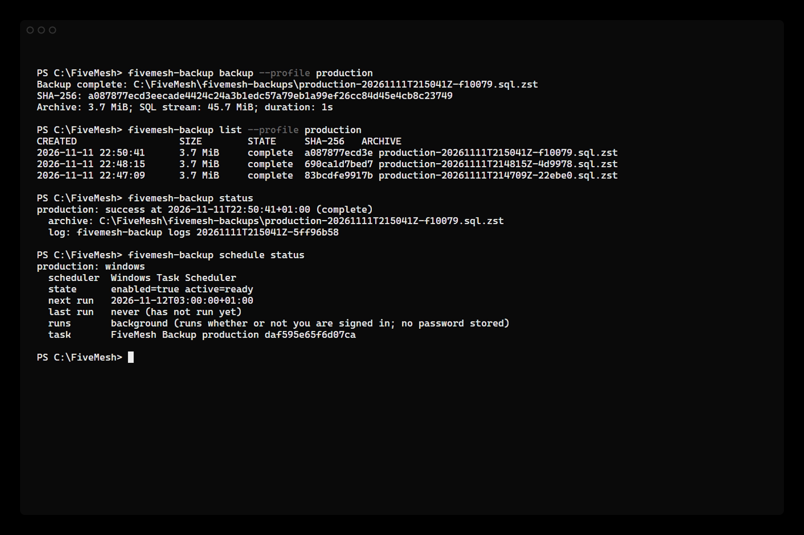
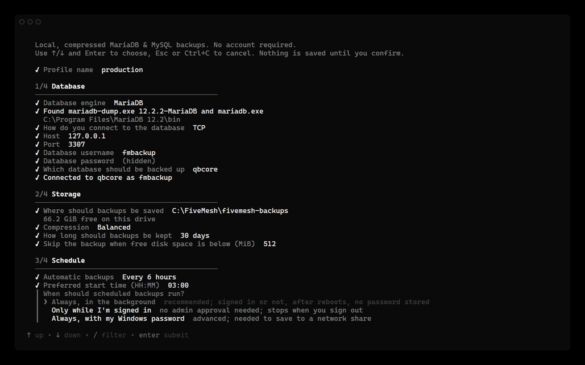

# FiveMesh Backup

Local-first, scheduled backups for MariaDB and MySQL, built for game-server
and small-infrastructure operators who want reliable database dumps without
running a backup service.



- **Guided setup.** One command connects, lists your databases, picks a folder
  and schedule, and runs a verified test backup.
- **Safe archives.** Native `mariadb-dump`/`mysqldump`, streamed through
  Zstandard, published atomically with a SHA-256 checksum, and fully verified.
- **Real scheduling, no daemon.** Windows Task Scheduler or systemd user timers
  run a short-lived backup command. On Windows, background mode keeps running
  after you sign out or reboot, with no stored Windows password.
- **Discord notifications.** Optional messages when backups succeed or fail,
  restores run, or settings change.
- **Your data stays yours.** No account, no cloud, no telemetry. Backups and
  credentials stay on your machine.

FiveMesh Backup backs up databases only, not game-server files.

## Requirements

| Platform | Architecture | Scheduling |
|---|---|---|
| Windows 10/11, Windows Server 2016+ | amd64 | Task Scheduler |
| Debian/Ubuntu and other systemd Linux | amd64, arm64 | systemd user timers |

The MariaDB or MySQL client tools must be installed on the machine running
FiveMesh Backup (`mariadb-dump` or `mysqldump`, plus `mariadb` or `mysql`).
They ship with every MariaDB/MySQL server install, XAMPP, Laragon, and WAMP.
FiveMesh Backup finds them automatically in the usual locations even when they
are not on `PATH`.

## Quick start

**Windows** (PowerShell, no admin needed):

```powershell
irm https://github.com/FiveMesh/fivemesh-backup/releases/latest/download/install.ps1 | iex
```

**Linux** (as the user that will own the backups, not root):

```sh
curl -fsSL https://github.com/FiveMesh/fivemesh-backup/releases/latest/download/install.sh | bash
```

The installer downloads the latest release, checks it against the release's
`SHA256SUMS`, installs it for your user (`%LOCALAPPDATA%\FiveMesh\bin` or
`~/.local/bin`), and starts guided setup. Run it again any time to upgrade;
configuration, schedules, and backups are kept.

Prefer to do it by hand? Download the binary for your platform from the
[releases page](https://github.com/FiveMesh/fivemesh-backup/releases), compare
it with `SHA256SUMS`, and run it. Running `fivemesh-backup` with no arguments
starts guided setup the first time and shows backup status afterwards. On
Windows you can also double-click the executable.

> Windows release binaries are not code-signed yet, so SmartScreen or your
> browser may warn about an unrecognized app. Check the file against
> `SHA256SUMS` (or `gh attestation verify`) before allowing it.



Setup walks through four steps:

1. **Database**: finds the client tools, asks how to connect, and lists the
   databases your account can see so you pick one instead of typing it.
2. **Storage**: backup folder, compression, and how long to keep backups.
3. **Schedule**: manual, every 6 or 12 hours, daily, or a custom interval.
4. **Review**: a summary of everything before anything is saved, followed by
   an optional real test backup that is verified end to end.

The prompts use arrow keys, inline validation, and masked password input. When
input is piped or the terminal is limited, setup automatically falls back to
plain numbered questions, which you can also force with
`FIVEMESH_BACKUP_PLAIN=1`.

### Use a dedicated database account

Backups only need read access. A dedicated account limits the damage if the
credentials file ever leaks:

```sql
CREATE USER 'fmbackup'@'127.0.0.1' IDENTIFIED BY 'choose-a-strong-password';
GRANT SELECT, SHOW VIEW, TRIGGER, EVENT, LOCK TABLES ON *.* TO 'fmbackup'@'127.0.0.1';
```

## Everyday commands



```sh
fivemesh-backup backup --profile production     # back up now and verify
fivemesh-backup list --profile production       # archives on disk
fivemesh-backup status                          # latest result per profile
fivemesh-backup verify --all --profile production
fivemesh-backup configure                       # change settings
```

Restore always targets a database you name explicitly, and asks you to type
that name to confirm:

```sh
fivemesh-backup restore --profile production \
  --archive /var/backups/fivemesh/production-20261020T060000Z-ab12cd.sql.zst \
  --database fxserver_restore_test
```

Restoring into a separate database first is the safest way to check a backup.

## Automatic backups

### Windows

Setup offers three ways to run scheduled backups:



| Mode | Runs when signed out / after reboot | Stores a Windows password | Setup |
|---|---|---|---|
| **Background** (recommended) | Yes | No | One administrator approval (UAC) |
| Only while signed in | No | No | None |
| With my Windows password | Yes | Yes, in Windows (LSA) | Needs "Log on as a batch job" |

Background mode creates a Task Scheduler task that runs as your account
whether or not you are signed in. Windows asks for administrator approval once
when the task is created or changed. Checking, running, pausing, and removing it
afterwards work from a normal console. No extra Windows user and no security
policy edits are needed.

The one limitation: background tasks cannot use Windows network credentials,
so the backup folder must be on a local drive. Use password mode to back up to
a network share.

You can also schedule without the wizard:

```powershell
fivemesh-backup schedule configure --profile production --frequency 6h --start-time 03:00
fivemesh-backup schedule status
fivemesh-backup schedule run --profile production
```

`--logon-mode` defaults to `background`; `--frequency` accepts `daily`, `6h`,
`12h`, or `custom` with `--interval-minutes`.
See [docs/windows-task-scheduler.md](docs/windows-task-scheduler.md).

### Linux

FiveMesh Backup installs a systemd user timer per profile:

```sh
fivemesh-backup schedule status
fivemesh-backup schedule enable --profile production
fivemesh-backup schedule next --profile production
```

To keep timers running after you log out:

```sh
sudo loginctl enable-linger "$USER"
```

See [docs/linux.md](docs/linux.md).

## Discord notifications

Get a message in your Discord channel when a backup succeeds or fails, a
restore runs, or settings change:

```sh
fivemesh-backup notify discord
```

Paste a webhook URL from **Server Settings → Integrations → Webhooks**, pick
the events, and a test message confirms it works. Notifications never block or
fail a backup, never ping `@everyone`, and the webhook URL is stored with your
other credentials. See [docs/notifications.md](docs/notifications.md).

## Where things are stored

| | Windows | Linux |
|---|---|---|
| Configuration and credentials | `%AppData%\fivemesh-backup` | `~/.config/fivemesh-backup` |
| Backups | the folder chosen during setup | the folder chosen during setup |

`FIVEMESH_BACKUP_HOME` overrides the configuration folder. Credentials live in
their own file, readable only by your account (plus SYSTEM and Administrators
on Windows). Upgrading or uninstalling never deletes configuration,
credentials, history, or archives.

## Security notes

- Database passwords never appear in command lines, logs, history, or task
  definitions; the dump client reads them from a short-lived protected file.
- Scheduled backups run with the rights of the account that set them up. If
  that account is an administrator, so is the backup; use a standard account
  for least privilege.
- `--single-transaction` gives a consistent snapshot of InnoDB tables only, not
  MyISAM or other non-transactional tables.

Report vulnerabilities privately as described in [SECURITY.md](SECURITY.md).
More detail: [docs/security.md](docs/security.md).

## Documentation

- [Configuration reference](docs/configuration.md)
- [Discord notifications](docs/notifications.md)
- [Windows scheduling](docs/windows-task-scheduler.md)
- [Linux scheduling](docs/linux.md)
- [Architecture](docs/architecture.md)
- [Testing](docs/testing.md) and [contributing](CONTRIBUTING.md)
- [Roadmap](docs/roadmap.md)

## License

MIT. See [LICENSE](LICENSE).
